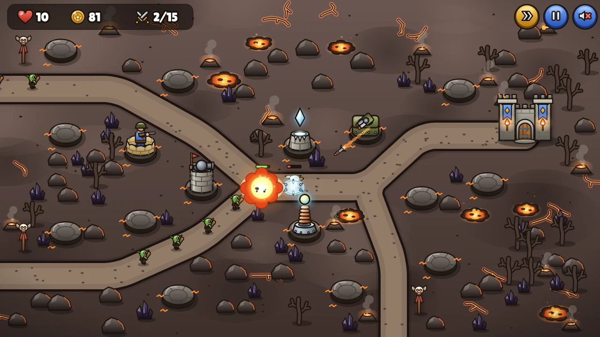
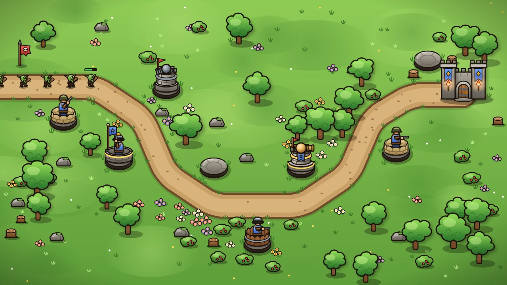
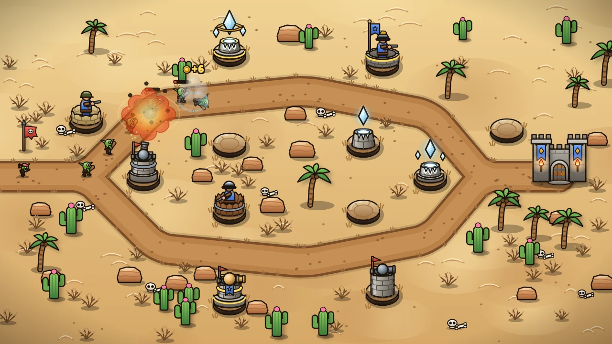
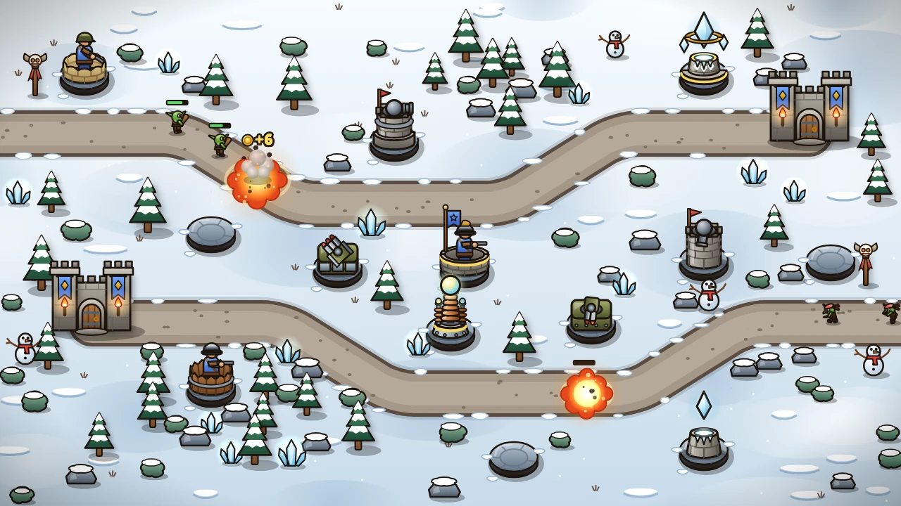
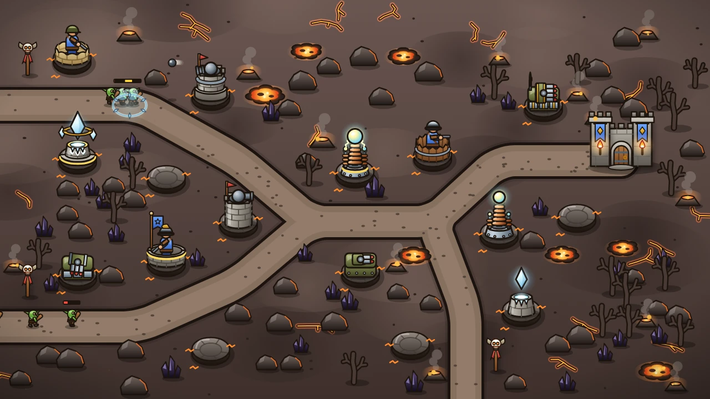
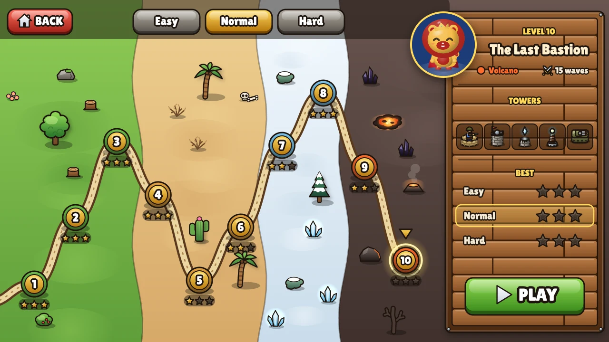
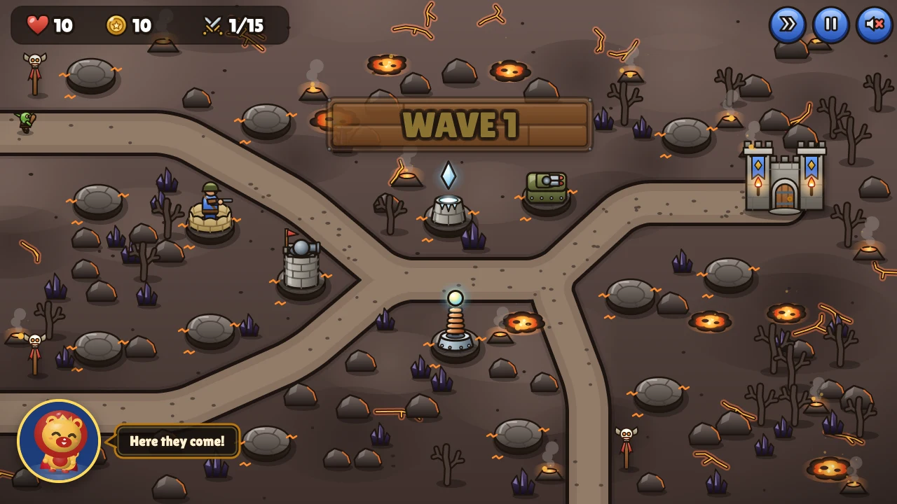
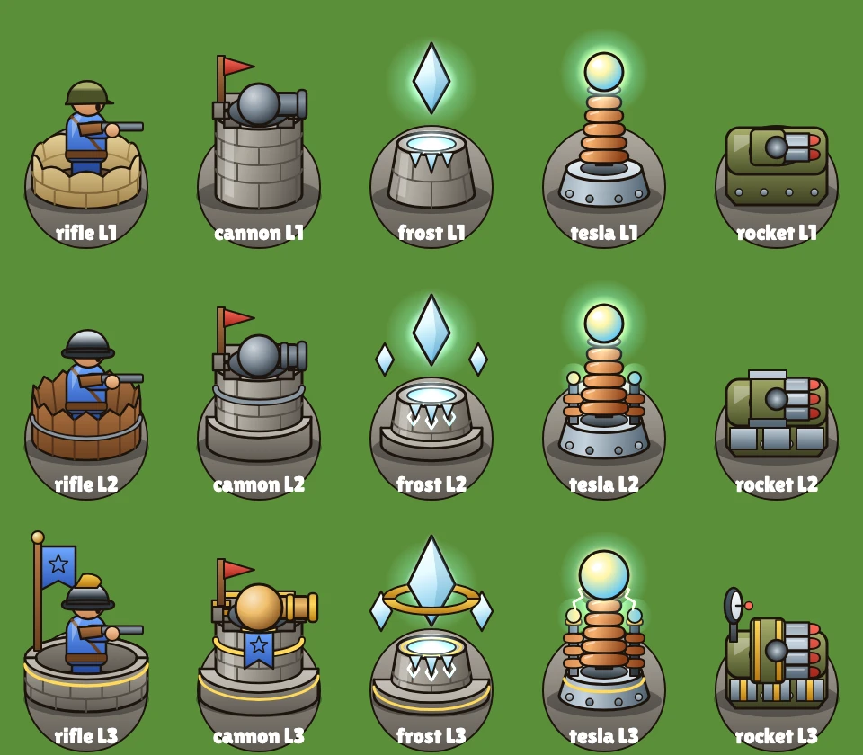
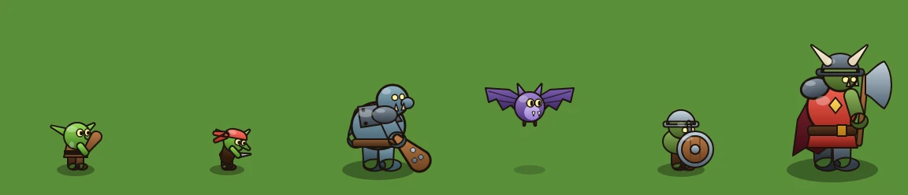

# Last Bastion

**A ten-level tower defense game for the browser, built by parallel Claude Code agents with
[arbab](https://github.com/ozgursagiroglu/arbab) and rendered with the [ExodeUI](https://www.exodeui.com/) runtime.**

[](https://github.com/ozgursagiroglu/last-bastion/actions/workflows/pages.yml)
[](LICENSE)


### [▶ Play it in your browser](https://ozgursagiroglu.github.io/last-bastion/)



Goblins, trolls, bats and shield orcs march down the road toward your castle. Build towers on the stone pads, upgrade
them, and hold the gate until the last wave falls. Every enemy that gets through costs lives; at zero, the castle is
lost.

- **10 levels** on four maps (meadow, desert, snow, volcano), with one to three roads.
- **5 towers**, three upgrade levels each: Rifleman, Cannon, Frost Tower, Tesla Coil and Rocket Launcher.
- **6 enemy types**: Goblin, Runner, Troll, Bat, Shield Orc and the Orc Warlord boss.
- **3 difficulties**: easy (25 lives), normal (20) and hard (10, with tougher, faster enemies and less gold).
- **Stars and saved progress**: up to three stars per level and difficulty from the lives you keep, saved in your
  browser.
- **King Sunny**, the lion king of the bastion, cheers you on and worries when the gate is in danger.

| Meadow | Desert |
| --- | --- |
|  |  |
| **Snow** | **Volcano** |
|  |  |

## How to play

| Action | Mouse | Keyboard |
| --- | --- | --- |
| Build a tower | Click an empty stone pad, then a tower | `1`–`5` while the build menu is open |
| Upgrade or sell | Click a tower, then upgrade or sell | `U` / `S` while the tower menu is open |
| Start the first wave | START | |
| Call the next wave early | NEXT (+1 gold for every second skipped) | |
| Pause | Pause button | `Space` or `Esc` |
| Double speed | Speed button | `F` |
| Sound on or off | Sound button | `M` |

Rifles, cannons and rockets deal physical damage, which armor reduces and shields halve; frost and tesla deal energy
damage, which ignores both. Cannons cannot hit flyers, rockets hit them extra hard, frost shards slow what they hit and
tesla bolts chain between enemies. The Orc Warlord costs 10 lives if he reaches the gate.



## How it was built

The game was built with arbab, a Claude Code plugin that turns one Claude Code session into an engineering team: the
session plans and writes narrow briefs, and arbab runs each brief as a headless Claude Code worker, in parallel, in its
own git worktree behind a sandbox.

```text
                                  ┌─> lane ─┐
orchestrator session + arbab ─────┼─> lane ─┼─> integrate ─> verify ─> review ─> readiness ─> person approves ─> main
(contracts, briefs, integration)  └─> lane ─┘
```

1. **Contracts first.** The orchestrator, an interactive Claude Code session, studied the ExodeUI runtime and wrote the
   shared ground every lane builds on: game types and stat tables, `SpriteBuilder` (a typed builder for ExodeUI
   artboards), the stage and engine helpers, and a Node render pipeline so tests and galleries can draw real frames.
2. **Lanes in waves.** Each lane got a brief with a fixed scope, decided facts and acceptance checks. Simulation,
   levels and art ran in parallel; then the world scene, HUD, menus and difficulty tuning; then the app shell, the
   engine effects and the mascot; last, the showcase (SEO, icons, media and the Pages deploy).
3. **Gates before main.** Every wave was integrated, then verified inside the sandbox (typecheck, the full test suite
   and the production build), reviewed for correctness, performance and security with a skeptic pass that tries to
   refute each finding, and checked for readiness. Confirmed findings went back to a lane with a test that fails
   without the fix. Nothing reached `main` until a person said yes.

The workers looked at their own work. Art lanes rendered every sprite, clip and variant to PNG with `pnpm art:render`
and iterated on what they saw; the tuning lane played every level on every difficulty with a headless bot (60 plays in
about 3 seconds, see [src/game/balance](src/game/balance/README.md)).

### Cost and time

| Area | What it covers | Time | Cost |
| --- | --- | ---: | ---: |
| Orchestrator | Plan, shared contracts, lane briefs, integration, browser captures, this README | 2 h 13 min | $90.30 |
| Simulation | Deterministic 60 Hz simulation, economy, waves, a headless balance bot | 23 min | $6.50 |
| Levels | The ten level definitions and their validation | 17 min | $4.71 |
| Difficulty tuning | Waves and starting gold tuned with the bot on every level and difficulty | 29 min | $8.43 |
| Tower art | Five towers at three levels, with aim and fire clips | 29 min | $8.16 |
| Enemy art | Six enemies with walk, hit and die clips | 21 min | $5.54 |
| World art | Terrain for four themes, decor, castle gates, projectiles and impact effects | 25 min | $8.49 |
| UI kit | Buttons, panels, icons, tags, range rings, hit testing | 14 min | $4.00 |
| HUD | In-game HUD, build and tower menus, wave banner, overlays | 17 min | $5.35 |
| Menus | Title screen, level select with difficulty | 13 min | $4.53 |
| World scene | Rendering adapter: terrain layer, pooled towers, enemies, projectiles and effects | 32 min | $9.14 |
| Engine effects | ExodeUI glows, light trails and particle emitters in the scene | 34 min | $11.74 |
| Mascot | King Sunny's reactions to the game, screen shake | 26 min | $10.39 |
| App shell | Screens, game loop, input, procedural audio, saved progress | 12 min | $3.32 |
| Review fixes | Confirmed review findings fixed with tests: adaptive effect quality, mascot timing, render costs | 28 min | $9.72 |
| Showcase | Pages deploy with a test suite sized for CI runners, SEO, icons, media | 52 min | $5.12 |
| Code review | Correctness, performance and security reviews with a skeptic pass | 1 h 17 min | $26.02 |
| Verification | Typecheck, tests and build inside the sandbox; worker preflight | 33 min | $0.25 |
| **Total** | **39 lanes and the orchestrator** | **10 h 15 min** | **$221.71** |

- **Elapsed working time: 6 h 16 min.** Lanes ran in parallel, so the work above fit into 6 h 16 min during which at
  least one agent was working.
- **Lanes**: 18 building lanes, 15 reviewer and skeptic lanes, and 6 verification and preflight lanes.
- **Time** is measured working time: lane run time from arbab's run records, and for the orchestrator, model and tool
  time from its session log. Time spent waiting for a person, for a usage-limit reset or with nothing running is not
  counted.
- **Cost** is API-equivalent: what the tokens cost at Claude API prices. For lanes it is the cost Claude Code reports
  for each run; for the orchestrator it is the session's logged token usage at Claude Opus 5.5 rates ($4 / $20 per
  million input / output tokens, $8 per million for one-hour cache writes, $0.20 per million for cache reads).
- **Models**: the orchestrator and every building and reviewing lane ran Claude Opus 5.5 (lanes at high effort);
  verification ran on Claude Haiku 5.5.

## How ExodeUI is used

ExodeUI is an interactive animation and UI runtime, a Rive alternative. Here its canvas engine draws the whole game:
every sprite, map, projectile, effect, HUD element and menu is an ExodeUI artboard, and the mascot is ExodeUI's own
mascot component.

- **Art as code.** Artboards are built in TypeScript with `SpriteBuilder` ([src/art/exode.ts](src/art/exode.ts)):
  shapes, Bézier paths, linear and radial gradients from a shared palette, outlined text and keyframe clips with
  easing. Builders are pure (objects in, artboard out), so every sprite is unit-tested and rendered to PNG in Node.
- **Engine-driven scene.** The engine's object list is fixed when an artboard loads, so enemies, projectiles and
  effects are pools of hidden instances. Each frame the scene adapter ([src/render/scene](src/render/scene)) writes
  positions, rotations, opacity, visibility and text from the simulation's view, and replays baked clips: walk cycles,
  recoil, hits and deaths.
- **Built-in effects.** Outer `Glow` on tesla spheres, frost crystals, lightning and explosions; `LightTrail` behind
  rockets, ice shards and cannonballs; `ParticleEmitter` sparks, debris, ice motes and volcano embers on a second,
  small engine over the world canvas. Their cost was measured per instance, and an adaptive guard turns them off when a
  device cannot keep its frame pace ([ENGINE_EFFECTS.md](src/art/world/ENGINE_EFFECTS.md)).
- **King Sunny.** ExodeUI's rigged *Sunny the Lion* (`ip-2011`) from its mascot library, recolored gold, crimson and
  royal blue through the `<exode-mascot>` web component. He greets you on the menus, pops up during a level when the
  first wave starts, a boss arrives, the gate is in danger or you clear waves without a leak, and celebrates or cries
  with you at the end.
- **What we learned about the runtime** is written down where the agents read it: the ExodeUI facts in
  [CLAUDE.md](CLAUDE.md) (transforms, paths, text, clips, layers, what not to use and why) and the measured effect
  costs in [ENGINE_EFFECTS.md](src/art/world/ENGINE_EFFECTS.md).



| Towers at levels 1, 2 and 3 | Enemies |
| --- | --- |
|  |  |

## Project layout

| Path | What |
| --- | --- |
| [src/game](src/game) | Shared types and stat tables, the deterministic simulation, the ten levels, balance tests. No DOM, no rendering |
| [src/art](src/art) | ExodeUI artboard builders: towers, enemies, world, UI kit, and the `SpriteBuilder` toolkit |
| [src/render](src/render) | Canvas stage, engine helpers and the world scene adapter |
| [src/ui](src/ui) | HUD and menus |
| [src/app](src/app) | App shell: screens, loop, input, audio, storage, mascot, quality guard |
| [src/platform](src/platform) | Node canvas rendering for tests and galleries |
| [scripts](scripts) | Gallery renderer, media renderer, SEO and media tests |

The simulation runs at a fixed 60 Hz step with no randomness or clock reads, so a level plays out the same way every
time; the balance tests rely on that. The project has 135 TypeScript source files, 10 art galleries and 110 test files
with 879 tests.

## Run it locally

Requires Node 24 and pnpm 12.

```sh
pnpm install
pnpm dev                 # play at http://localhost:5173
pnpm test                # unit, render and balance tests
pnpm typecheck
pnpm build               # production build in dist/
pnpm art:render [filter] # render gallery entries to out/renders/*.png
pnpm media               # render the icons and the Node-side README media
```

## FAQ

**What is Last Bastion?**
A free tower defense game that runs in the browser: ten levels on four themed maps, five towers with three upgrade
levels each, six enemy types including the Orc Warlord boss, and three difficulties.

**How was it built?**
With arbab: a Claude Code session wrote the shared contracts and the briefs, and arbab ran each part (simulation,
levels, art, scene, HUD, menus, tuning, app shell, effects, mascot) as a headless Claude Code worker in its own git
worktree. Verification, code review and a person's approval gated every merge.

**What is ExodeUI?**
An interactive animation and UI runtime, a Rive alternative. Every sprite, map, effect and menu here is an ExodeUI
artboard drawn by its canvas engine, and King Sunny comes from ExodeUI's mascot library.

**How much did it cost and how long did it take?**
10 h 15 min of measured agent work and $221.71 at API prices, within 6 h 16 min of elapsed working time. The
[cost table](#cost-and-time) breaks it down by area.

**Can I use the code?**
Yes, under the MIT license. The font and the mascot have their own terms, listed below.

## Third-party code and assets

- **ExodeUI runtime**: the [`exodeui`](https://www.npmjs.com/package/exodeui) npm package, pinned at 7.2.18 and
  bundled into the build.
- **The mascot component** is ExodeUI's official embed, loaded at runtime from
  `https://www.exodeui.com/mascots/exode-mascot.js`; its license is not stated, so it is not redistributed here. It
  runs with this page's privileges and cannot be pinned with Subresource Integrity, because exodeui.com sends no CORS
  headers. The page keeps only game progress and settings in `localStorage`, but a GitHub Pages project site shares
  its origin, and so its storage, with the owner's other project sites. If the script does not load, the game runs
  without the mascot ([src/app/mascot.ts](src/app/mascot.ts)).
- **The mascot art** (`public/mascots/ip-2011.bexode`, Sunny the Lion) comes from ExodeUI's mascot library, free for
  personal and commercial use. It is served from this site because the component cannot fetch it from exodeui.com
  across origins.
- **Lilita One** font (`public/fonts`), under the SIL Open Font License ([OFL.txt](public/fonts/OFL.txt)).

## License

[MIT](LICENSE) © 2026 Özgür Sağıroğlu.
